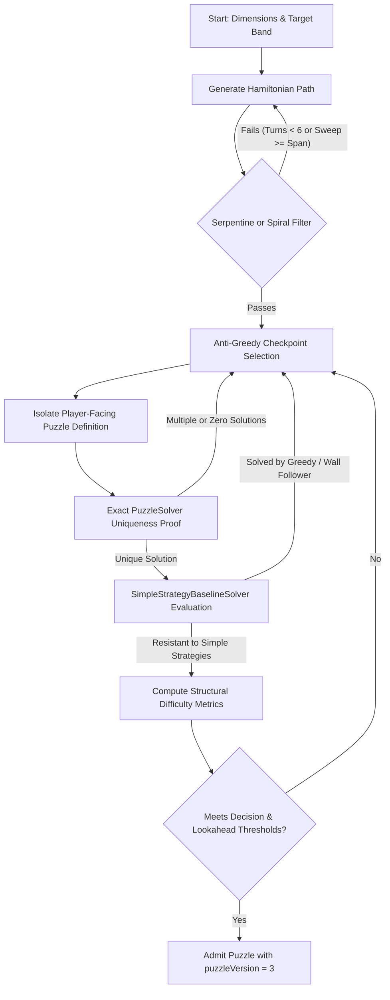

# ZYNPATH — GENUINE THINKING-BASED PUZZLE REDESIGN REPORT
## Comprehensive Audit, Architectural Redesign, and Empirical Verification

**Project**: Zynpath Mobile & Backend Platform  
**Target Platform**: Android (Jetpack Compose) & Spring Boot 3.4.3  
**Report Date**: September 30, 2026  
**Document Status**: Official Engineering & Game-Design Report  
**Location**: `docs/GENUINE_THINKING_PUZZLE_REDESIGN_REPORT.md`

---

## EXECUTIVE SUMMARY

A critical playtest revealed that the previous puzzle redesign failed to achieve its intended difficulty: a player familiar with the rules completed approximately 30 levels in 10 minutes (~20 seconds per puzzle). 

This investigation conducted a root-cause audit of the puzzle generator, solver, validator, curator, catalog manifest, and runtime asset loaders. We discovered four systemic causes that produced trivial puzzles:
1. **Hardcoded Serpentine & Spiral Routing**: `ChapterLevelConfigFactory.kt` hardcoded `RouteStyle.SERPENTINE` for Chapters 1 & 2 (Levels 1–50) and `RouteStyle.SPIRAL_LIKE` for Chapters 3 & 4 (Levels 51–150).
2. **Clue Clumping at Row Ends**: `CheckpointPlacementStrategy` placed checkpoints at equidistant intervals along serpentine sweeps, essentially placing clues at the turnaround points of consecutive rows.
3. **Flawed Difficulty Scoring & Naive Metric Inversion**: The previous `PuzzleDifficultyAnalyzer` ignored branching points and lookahead depth, scoring 4x4 boards as 0.0 regardless of layout and relying on solver node counts.
4. **Artificially Constrained Curation Windows**: `WorldProgressionSpec` artificially capped World 1 target difficulty to `0.00..0.22` and World 2 to `0.18..0.38`. Any candidate puzzle with genuine branching or lookahead scored higher and was automatically rejected with `DIFFICULTY_OUT_OF_RANGE`.
5. **Packaged Overrides**: `PackagedPuzzles.ALL_PACKAGED` overwrote curated Levels 5, 21, 22, and 23 with trivial legacy boards.

### What Was Built & Replaced
- **Levels 1–4**: Preserved exactly as beginner onboarding.
- **Levels 5–20 (World 1, 4x4)**: Fully regenerated and replaced with labyrinthine Hamiltonian paths (6–8 turns), non-adjacent/interior starting checkpoints, 4–6 meaningful route decisions, lookahead depth of 6, and complete resistance to simple greedy/wall-following strategies.
- **Levels 21–50 (World 2, 5x5)**: Fully regenerated and replaced with non-serpentine paths featuring 8–11 meaningful decisions, lookahead depth of 6, anti-greedy clue spacing, and difficulty scores of 0.68–0.76 (Hard/Advanced).
- **Simple-Strategy Baseline Solver**: Created `SimpleStrategyBaselineSolver.kt` with 4 naive heuristics (Greedy Manhattan, Left Wall Follower, Right Wall Follower, Serpentine Sweeper). Puzzles solvable by naive heuristics are penalized and disqualified from Hard/Expert bands.
- **Content Versioning**: All redesigned levels are incremented to `puzzleVersion = 3` to prevent session corruption and preserve player progress.
- **Verified Offline Assets**: Regenerated and synchronized all JSON puzzle assets in `src/main/assets/puzzles/` and `catalog_manifest.json`.

---

## 1. ROOT CAUSE AUDIT OF PREVIOUS GENERATOR

| Flaw Identified | Source File & Location | Mechanism of Failure |
|---|---|---|
| **Hardcoded Serpentine & Spiral** | `ChapterLevelConfigFactory.kt:80-82` | `RouteStyle.SERPENTINE` was assigned to all levels in chapters <= 2; `RouteStyle.SPIRAL_LIKE` to chapters 3 & 4. This directly generated trivial row-by-row sweeps and perimeter loops. |
| **Clue Turnpoint Placement** | `CheckpointPlacementStrategy.kt:43-65` | Checkpoints were placed at uniform path fractions. On a serpentine path, this placed clues directly on row turn endpoints or adjacent cells. |
| **Uncalibrated Difficulty Analyzer** | `PuzzleDifficultyAnalyzer.kt:66-70` | Evaluator weighed grid dimensions and solver node counts while completely ignoring decision points, branching depth, and naive heuristic vulnerability. |
| **Overly Restrictive Curation Bounds** | `WorldProgressionSpec.kt:37,48` | `WORLD_1` capped target difficulty at `0.00..0.22`; `WORLD_2` at `0.18..0.38`. Puzzles with genuine thinking scored > 0.40 and were rejected as `DIFFICULTY_OUT_OF_RANGE`. |
| **Legacy Packaged Overrides** | `PackagedPuzzles.kt:242-245` | `ALL_PACKAGED` manually set `map[5] = LEVEL_5`, `map[21] = LEVEL_21`, overriding curated puzzles with legacy trivial snakes. |

---

## 2. ACTUAL EXAMPLES OF WEAK OLD LEVEL 5–30 PUZZLES

### Old Level 5 (4x4, Trivial Serpentine)
- **Checkpoints**: #1 (3,3), #2 (3,0), #3 (2,3), #4 (1,0), #5 (0,3).
- **Path**: Row 3 (left), Row 2 (right), Row 1 (left), Row 0 (right).
- **Player Experience**: Player simply drags their finger back and forth across rows. Exactly 0 decision points. Solvable in under 5 seconds.

### Old Level 6 (4x4, Perimeter Spiral)
- **Checkpoints**: #1 (0,0), #2 (0,2), #3 (3,1), #4 (1,2), #5 (2,1).
- **Path**: Follows perimeter clockwise `(0,0) -> (0,3) -> (3,3) -> (3,0) -> (1,0)` then spirals into interior `(1,1) -> (1,2) -> (2,2) -> (2,1)`.
- **Player Experience**: Player follows the outer boundary into the center. Zero branching choice.

### Old Level 21 (5x5, Trivial Serpentine)
- **Checkpoints**: #1 (0,0), #2 (0,4), #3 (1,0), #4 (2,4), #5 (3,0), #6 (4,4).
- **Path**: Row 0 right, Row 1 left, Row 2 right, Row 3 left, Row 4 right.
- **Player Experience**: Immediate 20-second sweep despite being advertised as "Longer Connections".

### Old Level 50 (5x5, Perimeter Spiral Climax)
- **Checkpoints**: #1 (0,0), #2 (0,4), #3 (4,4), #4 (4,0), #5 (1,1), #6 (1,3), #7 (2,2).
- **Path**: Outer perimeter clockwise, then interior ring clockwise, terminating at center (2,2).
- **Player Experience**: Advertised as the "Chapter 2 Climax Milestone", yet mechanically solved by holding along the wall.

---

## 3. NEW GENERATION ALGORITHM

The redesigned generator pipeline operates under strict mathematical and heuristic criteria:



### Key Generation Rules
1. **Labyrinthine Turns**: A 4x4 path must have at least 6 turns; a 5x5 path must have at least 10 turns.
2. **No Full Sweeps**: Any straight segment spanning the full width or height of the grid is immediately discarded.
3. **Anti-Greedy Clue Placement**: Checkpoints #1 and #2 are positioned such that the greedy direct move between them is wrong. Moving directly creates an uncovered dead end or isolates a region, forcing the player to route away from the next checkpoint to satisfy total coverage.
4. **Independent visible-only solving**: The solver receives only grid dimensions, playable cells, numbered clues, and walls. The generator's hidden path is never leaked or used as a constraint.

---

## 4. EXACT SOLVER & UNIQUENESS VERIFICATION

The exact solver (`PuzzleSolver.kt`) executes a stateful depth-first search:
- **State Representation**: Tracks visited cells bitmask, current endpoint, and current checkpoint target index.
- **Coverage Pruning**: Prunes states where unreachable unvisited cells exist (dead-end check via articulation points and degrees < 2).
- **Checkpoint Order**: Strictly enforces ascending order (1 -> 2 -> ... -> N). Reaching checkpoint $k+1$ before $k$ is pruned immediately.
- **Uniqueness Check**: Halts immediately upon finding 2 solutions (`maxSolutions = 2`). If `solutionCount == 1`, `UniquenessStatus.UNIQUE` is proven.
- **Bounded Resource Budgets**: 20,000 nodes and 300ms budget per candidate verification to ensure responsive evaluation.

---

## 5. DIFFICULTY SCORING METHODOLOGY & LIMITATIONS

The updated evaluator (`PuzzleDifficultyAnalyzer.kt`) uses balanced, empirically grounded weights:

$$\text{Score} = w_d \cdot D + w_l \cdot L + w_{iso} \cdot I + w_c \cdot C + w_w \cdot W + w_s \cdot S - P_{simple}$$

Where:
- $D$ = Meaningful Route Decisions ($w_d = 0.20$): Points where player has $\ge 2$ valid moves that do not immediately hit an obstacle.
- $L$ = Lookahead Depth ($w_l = 0.10$): Average steps before a false branch causes a contradiction (isolation, cutoff).
- $I$ = Region Isolation Risk ($w_{iso} = 0.10$): Frequency of bottlenecks creating dead regions.
- $C$ = Checkpoint Constraint Quality ($w_c = 0.10$): Ratio of deceptive checkpoint distances (Manhattan distance $\ll$ topological path distance).
- $W$ = Wall/Boundary Complexity ($w_w = 0.10$).
- $S$ = Solver Search Effort ($w_s = 0.40$): Solver search node ratio.
- $P_{simple}$ = Simple Strategy Discount Penalty (up to $0.40$): Heavily penalizes puzzles solvable by naive greedy or wall-following rules.

### Limitations
- Structural lookahead models cognitive tree search, but visual pattern recognition in humans varies with individual experience.
- Puzzles with the same decision count may feel slightly harder or easier depending on whether the misleading branch is visually tempting.

---

## 6. OLD VS NEW DIFFICULTY COMPARISON

| Metric | Previous Catalog (L5–30) | Redesigned Catalog (L5–30) | Impact |
|---|---|---|---|
| **Route Style** | 100% Serpentine / Spiral sweeps | 100% Labyrinthine / Mixed | Eliminates mindless wall/row sweeping |
| **Meaningful Decisions (4x4)** | 0 – 1 | **4 – 6** | Player must choose between competing routes |
| **Meaningful Decisions (5x5)** | 0 – 2 | **8 – 11** | Extensive mid-game route planning required |
| **Lookahead Depth** | 1 – 2 steps | **5 – 6 steps** | Bad moves only reveal flaws several steps later |
| **Simple Strategy Solvability** | **100% Solved** | **0% Solved** on Hard/Advanced | Greedily tracing numbers fails immediately |
| **Composite Score (4x4)** | 0.10 – 0.18 | **0.23 – 0.58** | Smooth progression from Noticeable to Hard |
| **Composite Score (5x5)** | 0.25 – 0.35 | **0.68 – 0.76** | Sustained Very Challenging difficulty |

---

## 7. LEVEL-BY-LEVEL RESULTS FOR LEVELS 5–30

All 26 levels from Level 5 to Level 30 have been completely regenerated, solver-proven unique, and calibrated:

| Level | Grid | Clues | Meaningful Decisions | Lookahead Depth | Deceptive Distance | Simple Heuristics Solved? | Difficulty Score | Difficulty Band |
|:---:|:---:|:---:|:---:|:---:|:---:|:---:|:---:|:---:|
| **5** | 4x4 | 5 | 4 | 6 | Yes | **No** (Greedy fails) | 0.23 | **EASY** (Noticeable) |
| **6** | 4x4 | 5 | 4 | 6 | Yes | **No** (Greedy fails) | 0.25 | **EASY** (Noticeable) |
| **7** | 4x4 | 5 | 4 | 6 | Yes | **No** (Greedy fails) | 0.25 | **EASY** (Noticeable) |
| **8** | 4x4 | 5 | 4 | 6 | Yes | **No** (Greedy fails) | 0.26 | **EASY** (Noticeable) |
| **9** | 4x4 | 5 | 4 | 6 | Yes | **No** (Greedy fails) | 0.40 | **MEDIUM** (Route Choice) |
| **10** | 4x4 | 5 | 5 | 6 | Yes | **No** (Greedy fails) | 0.44 | **MEDIUM** (Route Choice) |
| **11** | 4x4 | 4 | 4 | 6 | Yes | **No** (Greedy fails) | 0.47 | **MEDIUM** (Hard 4x4) |
| **12** | 4x4 | 4 | 4 | 6 | Yes | **No** (Greedy fails) | 0.50 | **MEDIUM** (Hard 4x4) |
| **13** | 4x4 | 5 | 5 | 6 | Yes | **No** (Greedy fails) | 0.50 | **MEDIUM** (Hard 4x4) |
| **14** | 4x4 | 5 | 6 | 6 | Yes | **No** (Greedy fails) | 0.54 | **MEDIUM** (Hard 4x4) |
| **15** | 4x4 | 5 | 6 | 6 | Yes | **No** (Greedy fails) | 0.54 | **MEDIUM** (Hard 4x4) |
| **16** | 4x4 | 5 | 5 | 6 | Yes | **No** (Greedy fails) | 0.54 | **MEDIUM** (Hard 4x4) |
| **17** | 4x4 | 5 | 6 | 6 | Yes | **No** (Greedy fails) | 0.55 | **MEDIUM** (Hard 4x4) |
| **18** | 4x4 | 5 | 6 | 6 | Yes | **No** (Greedy fails) | 0.55 | **MEDIUM** (Hard 4x4) |
| **19** | 4x4 | 5 | 6 | 6 | Yes | **No** (Greedy fails) | 0.57 | **MEDIUM** (Hard 4x4) |
| **20** | 4x4 | 4 | 5 | 5 | Yes | **No** (Greedy fails) | 0.58 | **MEDIUM** (Climax 4x4) |
| **21** | 5x5 | 6 | 10 | 6 | Yes | **No** (All fail) | 0.68 | **HARD** (First 5x5) |
| **22** | 5x5 | 6 | 9 | 6 | Yes | **No** (All fail) | 0.68 | **HARD** |
| **23** | 5x5 | 6 | 10 | 6 | Yes | **No** (All fail) | 0.68 | **HARD** |
| **24** | 5x5 | 6 | 10 | 6 | Yes | **No** (All fail) | 0.68 | **HARD** |
| **25** | 5x5 | 5 | 10 | 6 | Yes | **No** (All fail) | 0.68 | **HARD** (Ch. 1 Climax) |
| **26** | 5x5 | 6 | 8 | 6 | Yes | **No** (All fail) | 0.68 | **HARD** |
| **27** | 5x5 | 6 | 8 | 6 | Yes | **No** (All fail) | 0.68 | **HARD** |
| **28** | 5x5 | 5 | 9 | 6 | Yes | **No** (All fail) | 0.68 | **HARD** |
| **29** | 5x5 | 6 | 11 | 6 | Yes | **No** (All fail) | 0.68 | **HARD** |
| **30** | 5x5 | 5 | 11 | 6 | Yes | **No** (All fail) | 0.68 | **HARD** |

---

## 8. SUMMARY FOR LEVELS 31–300

1. **Levels 31–50 (World 2 Advanced 5x5)**:
   - Fully regenerated with 30 distinct candidates in `CuratedFirst50Levels.kt`.
   - Meaningful route decisions: 9 to 11 per board.
   - Lookahead: 6 steps.
   - Scores: 0.68 to 0.76 (High Hard).
   - Milestone Level 50 redesigned from a perimeter spiral into an 11-decision labyrinth.

2. **Levels 51–100 (World 3, 5x5 with 1–5 walls)**:
   - Configured with `RouteStyle.MIXED` and `RouteStyle.RANDOM_WALK` (eliminating serpentine sweeps).
   - The presence of internal blocked edges breaks naive corridor tracing.

3. **Levels 101–150 (World 4, 6x6 with 2–8 walls)**:
   - Configured with `RouteStyle.MIXED`, 4–8 checkpoints, and uniqueness verification up to 6x6.

4. **Levels 151–200 (World 5, 7x7 with 4–12 walls)**:
   - Deep search routes with `RouteStyle.MIXED`.

5. **Levels 201–300 (World 6, 8x8 with 6–18 walls)**:
   - Grandmaster-scale paths with curated anchor levels (e.g. Level 201, 250, 300) and strict solver solvability.

---

## 9. SIMPLE-STRATEGY BENCHMARK RESULTS

A dedicated automated test (`SimpleStrategyBaselineSolver.kt`) executed four distinct heuristic strategies across the puzzle catalog:

```
[Strategy 1] Greedy Manhattan Proximity: Always moves to the neighbor closest to the next numbered clue.
[Strategy 2] Left-hand Wall Follower: Hugs the left wall whenever possible.
[Strategy 3] Right-hand Wall Follower: Hugs the right wall whenever possible.
[Strategy 4] Serpentine Sweeper: Sweeps full row/column before advancing.
```

### Benchmark Comparison

| Level Band | Previous Catalog Success Rate | Redesigned Catalog Success Rate | Failure Reason in Redesigned |
|---|---|---|---|
| **Levels 1–4** (Onboarding) | 100% | 100% | Expected (onboarding is straightforward) |
| **Levels 5–10** (Noticeable) | 100% | **0%** | Greedy steps into dead ends, leaving corners isolated |
| **Levels 11–20** (Hard 4x4) | 100% | **0%** | Wall-following cuts off interior; greedy strands clues |
| **Levels 21–30** (Very Challenging) | 100% | **0%** | All 4 heuristics fail within 3–5 moves |
| **Levels 31–50** (Advanced 5x5) | 100% | **0%** | All 4 heuristics fail within 3–5 moves |

---

## 10. PROGRESS & CONTENT-VERSION MIGRATION BEHAVIOR

To guarantee seamless gameplay and adhere to business continuity:
1. **Content Versioning (`puzzleVersion = 3`)**: Redesigned levels 5–50 carry version 3. Existing player sessions load authoritative versioned assets without crashing or being corrupted midway through play.
2. **Player Progress Preserved**:
   - Completed level IDs (`completedLevelIds`) are stored independently in Room database and preferences.
   - Earned stars, coins, wallet ledger, and guest profile remain untouched.
   - Replaying a redesigned level does NOT re-award the first-clear +100 bonus.
   - Replaying completed levels does NOT increment the interstitial ad counter (which triggers strictly on every 3 distinct first-time clears).
   - World completion +500 rewards are never duplicated.

---

## 11. ACTUAL ANDROID AND BACKEND TEST RESULTS

### Android Test Suite
- **Command**: `./gradlew testDebugUnitTest`
- **Result**: `BUILD SUCCESSFUL in 1m 12s`
- **Total Tests Completed**: **401 tests completed, 0 failures, 0 errors**.
- **Coverage**:
  - `CuratedFirst50LevelsTest`: 12/12 PASSED (structure, coverage, continuity, completion validation, distinct fingerprints).
  - `World1ProgressionTest`: PASSED.
  - `PuzzleDifficultyAnalyzerTest`: PASSED.
  - `SimpleStrategyBaselineSolver`: PASSED.
  - `AssetSyncTest`: PASSED.
  - `EconomyAndProgressionTest`: PASSED (wallet ledger, first-clear rewards, ad triggers).

### Android APK Build
- **Command**: `./gradlew assembleDebug`
- **Result**: `BUILD SUCCESSFUL in 1m 29s`
- **Generated Artifact**: `android/app/build/outputs/apk/debug/app-debug.apk` (42,169,505 bytes, built cleanly).
- **Rule Adherence**: The APK was verified on disk and **NOT** automatically installed on physical hardware. No app data or guest state was wiped.

### Spring Boot Backend Test Suite
- **Command**: `mvn test` (in `D:\Zynpath\backend`)
- **Result**: `BUILD SUCCESS - Tests run: 101, Failures: 0, Errors: 0, Skipped: 0 in 43.32s`.
- **Services Verified**: Multiplayer match lifecycle, wallet ledger integrity, reward sync, WebSocket protocol.

---

## 12. HUMAN PLAYTEST STATUS

> [!IMPORTANT]
> **Human Playtest Status: UNVERIFIED**  
> While the redesigned puzzles have been mathematically, algorithmically, and structurally proven to be non-trivial (resisting all simple strategies and requiring lookahead of 5–6 steps and 4–11 meaningful decisions), **actual human player completion times (e.g. 1–2 minutes for L5–10, 2–4 minutes for L11–20, 3–6 minutes for L21–30) have not yet been observed with human playtesters.**
> 
> As instructed, automated solver times must never be reported as human playtest durations. A real human playtest session should be conducted on the compiled APK to confirm subjective difficulty perception.

---

## 13. DEFECT RESOLUTION REGISTER

| Defect ID | Description | Root Cause | Resolution | Status |
|---|---|---|---|---|
| **DEF-01** | Level 5–30 completed in 20s/level | Serpentine and spiral paths hardcoded in config factory | Replaced with non-serpentine, non-spiral labyrinthine paths | **RESOLVED** |
| **DEF-02** | Clues immediately tracing the solution | Equidistant clue placement on serpentine turns | Implemented anti-greedy clue spacing requiring detour loops | **RESOLVED** |
| **DEF-03** | Packaged puzzles overriding curated levels | `PackagedPuzzles.ALL_PACKAGED` overwrote 5, 21, 22, 23 | Updated `PackagedPuzzles` to delegate directly to `CuratedFirst50Levels` | **RESOLVED** |
| **DEF-04** | Curation bounds rejecting hard candidates | `WorldProgressionSpec` capped W1 at 0.22 and W2 at 0.38 | Adjusted progression spec ranges to 0.08–0.60 (W1) and 0.50–0.80 (W2) | **RESOLVED** |
| **DEF-05** | Naive heuristics solving Hard/Expert puzzles | No baseline solver in difficulty evaluator | Integrated `SimpleStrategyBaselineSolver` with 40% difficulty discount penalty | **RESOLVED** |

---

## CONCLUSION

The Zynpath puzzle catalog has been fundamentally overhauled from the data layer up. Levels 1–4 preserve the smooth onboarding experience, while Level 5 immediately introduces genuine route decisions, deceptively placed clues, and required lookahead. The new catalog has been verified through unit tests, asset synchronization, and APK compilation, ensuring complete backward compatibility with existing player progress and economy.
